# Phase 5: 10 New Team Battle Games Implementation Plan

> **For agentic workers:** REQUIRED SUB-SKILL: Use superpowers:executing-plans or superpowers:subagent-driven-development to implement this plan task-by-task. Steps use checkbox (`- [ ]`) syntax for tracking.

**Goal:** Expand Family Game Hub by adding 10 authentic, group-versus-group competitive party games with a dedicated "Team Battle Games" category, offline procedural content generation, dual-screen TV audience concealment, and tournament mode integration.

**Architecture:** Extend the existing modular architecture of Family Game Hub without adding third-party dependencies. Each game lives in `src/games/<gameId>/` with dedicated Host and TV components, synchronizing across windows via `hubSyncBus` (`BroadcastChannel`). Offline procedural generators with rich English and Filipino datasets feed into `contentEngine.ts` and `DynamicContentGeneratorSection.tsx`.

**Architecture Diagram:**

```mermaid
graph TD
    subgraph "Hub & Navigation"
        Navbar[HubNavbar]
        Home[MainHubPage]
        Setup[GameSetupHubPage]
        Host[HubHostPage]
        TV[HubDisplayPage]
        Tourney[TournamentModeModal]
    end

    subgraph "Catalog & Types"
        HubTypes[types/hub.ts]
        Registry[games/registry.ts]
        TourneyMgr[services/tournamentManager.ts]
    end

    subgraph "10 Team Battle Games"
        G1[Password]
        G2[Catchphrase]
        G3[Taboo]
        G4[Jeopardy]
        G5[Wheel of Fortune]
        G6[Bluff the Answer]
        G7[Heads Up]
        G8[Word Hunt]
        G9[Scattergories]
        G10[Trivia Elimination]
    end

    subgraph "Content & Engine"
        ContentEng[services/contentEngine.ts]
        LocalGen[services/localGenerators/]
        SyncBus[sync/hubSync.ts]
        Audio[audio/soundManager.ts]
    end

    Home --> Registry
    Setup --> ContentEng
    Setup --> TourneyMgr
    Host --> SyncBus
    Host --> Audio
    Host --> G1 & G2 & G3 & G4 & G5 & G6 & G7 & G8 & G9 & G10
    TV --> SyncBus
    TV --> G1 & G2 & G3 & G4 & G5 & G6 & G7 & G8 & G9 & G10
    ContentEng --> LocalGen
```



**Tech Stack:** React 19, TypeScript (strict mode, `verbatimModuleSyntax`), Tailwind CSS, Lucide React, Vitest, Playwright, Dexie v3.

**Spec:** [`docs/superpowers/specs/2026-11-10-phase-5-team-battle-games-design.md`](file:///c:/Projects/family-feud/docs/superpowers/specs/2026-11-10-phase-5-team-battle-games-design.md)

## Global Constraints
- Preserve 100% of Family Feud (39 packs, 20 Fast Money sets / 100 questions) and existing 5 hub games with zero regressions.
- CSS tokens declared at `:root`, instant `:focus-visible`, no generic AI-slop layouts or emojis as icons.
- Audience Concealment: secret words, taboo lists, and true answers must be omitted from TV display broadcast until host triggers reveal.
- Offline-first: all 10 games must be 100% playable without external API keys via procedural generators.

## Review Focus
1. Audience Concealment Leakage: TV display receives secret answer before reveal event -> pin with unit test verifying TV state does not contain secret word.
2. Word Hunt Path Adjacency: Word submitted is in dictionary but cannot be traced on 4x4 matrix -> test DFS adjacency validator rejects non-adjacent letters.
3. Jeopardy Point Balances: Team buzzes in and answers incorrectly -> test points are correctly deducted from team bank, allowing negative values.
4. Wheel of Fortune Vowel Buying: Team attempts to buy a vowel without having at least 250 points in current round bank -> verify action is rejected.
5. Trivia Elimination Life Loss: Team with 1 life answers wrong -> verify status transitions to `eliminated` and game ends when 1 team remains.

---

### Task 1: Catalog, Types & Tournament Expansion

**Files:**
- Modify: `src/types/hub.ts:44-51`
- Modify: `src/games/registry.ts:1-128`
- Modify: `src/services/tournamentManager.ts:50-80`
- Test: `src/services/tournamentManager.test.ts`

**Interfaces:**
- Produces: `GameCatalogId` union with all 16 games; `GAMES_CATALOG` with 16 registered items.

- [ ] **Step 1: Write the failing test for new game IDs in tournament manager**
  In `src/services/tournamentManager.test.ts`, add a test creating a tournament with `'jeopardy'` and `'wheel-of-fortune'`.
- [ ] **Step 2: Run test to verify it fails**
  Run: `npx vitest run src/services/tournamentManager.test.ts`
  Expected: FAIL with TypeScript type errors on new game IDs.
- [ ] **Step 3: Update `GameCatalogId` and `GAMES_CATALOG`**
  Add the 10 game IDs to `src/types/hub.ts`. Add all 10 games with full descriptions, rules, min/max players, and category `'Team Battle Games'` (or `'TV Game Show'`) in `src/games/registry.ts`. Update `tournamentManager.ts` mapping.
- [ ] **Step 4: Run test to verify it passes**
  Run: `npx vitest run src/services/tournamentManager.test.ts`
  Expected: PASS
- [ ] **Step 5: Commit**
  ```bash
  git add src/types/hub.ts src/games/registry.ts src/services/tournamentManager.ts src/services/tournamentManager.test.ts
  git commit -m "feat(hub): register 10 new team battle games in catalog and tournament manager"
  ```

---

### Task 2: Procedural Content Generators for 10 Games

**Files:**
- Create: `src/services/localGenerators/passwordGenerator.ts`
- Create: `src/services/localGenerators/catchphraseGenerator.ts`
- Create: `src/services/localGenerators/tabooGenerator.ts`
- Create: `src/services/localGenerators/jeopardyGenerator.ts`
- Create: `src/services/localGenerators/wheelGenerator.ts`
- Create: `src/services/localGenerators/bluffGenerator.ts`
- Create: `src/services/localGenerators/headsUpGenerator.ts`
- Create: `src/services/localGenerators/wordHuntGenerator.ts`
- Create: `src/services/localGenerators/scattergoriesGenerator.ts`
- Create: `src/services/localGenerators/eliminationGenerator.ts`
- Modify: `src/services/contentEngine.ts`
- Test: `src/services/contentEngine.test.ts`

**Interfaces:**
- Produces: `generatePasswordContent`, `generateCatchphraseContent`, `generateTabooContent`, `generateJeopardyContent`, `generateWheelContent`, `generateBluffContent`, `generateHeadsUpContent`, `generateWordHuntContent`, `generateScattergoriesContent`, `generateEliminationContent`.

- [ ] **Step 1: Write failing tests in `contentEngine.test.ts`**
  Add tests asserting generation of content for each of the 10 new games.
- [ ] **Step 2: Run test to verify it fails**
  Run: `npx vitest run src/services/contentEngine.test.ts`
  Expected: FAIL (modules not found / functions not exported).
- [ ] **Step 3: Implement the 10 procedural generators**
  Each generator contains English and Filipino datasets with category filtering and random sample selection. `wordHuntGenerator.ts` includes standard Boggle letter frequencies and DFS path adjacency checking. Wire into `contentEngine.ts`.
- [ ] **Step 4: Run tests to verify they pass**
  Run: `npx vitest run src/services/contentEngine.test.ts`
  Expected: PASS (all tests pass).
- [ ] **Step 5: Commit**
  ```bash
  git add src/services/localGenerators/ src/services/contentEngine.ts src/services/contentEngine.test.ts
  git commit -m "feat(content): add offline procedural generators for 10 team battle games"
  ```

---

### Task 3: Implement Game Engines (Group 1: Password, Catchphrase, Taboo)

**Files:**
- Create: `src/games/password/PasswordHostView.tsx`
- Create: `src/games/password/PasswordTvView.tsx`
- Create: `src/games/catchphrase/CatchphraseHostView.tsx`
- Create: `src/games/catchphrase/CatchphraseTvView.tsx`
- Create: `src/games/taboo/TabooHostView.tsx`
- Create: `src/games/taboo/TabooTvView.tsx`
- Test: `src/games/group1Games.test.ts`

**Interfaces:**
- Consumes: `hubSyncBus`, `soundManager`, `ScoreboardParticipant`
- Produces: Host consoles and TV mirror views with audience concealment.

- [ ] **Step 1: Write failing unit test for Group 1 state logic**
  Test password point ladder (10 -> 8 -> 6 -> 4), catchphrase pass turns, taboo strike deductions.
- [ ] **Step 2: Run test to verify it fails**
  Run: `npx vitest run src/games/group1Games.test.ts`
  Expected: FAIL.
- [ ] **Step 3: Implement Password, Catchphrase, and Taboo components**
  Build `<PasswordHostView>` / `<PasswordTvView>`, `<CatchphraseHostView>` / `<CatchphraseTvView>`, `<TabooHostView>` / `<TabooTvView>`.
- [ ] **Step 4: Run tests to verify they pass**
  Run: `npx vitest run src/games/group1Games.test.ts`
  Expected: PASS.
- [ ] **Step 5: Commit**
  ```bash
  git add src/games/password/ src/games/catchphrase/ src/games/taboo/ src/games/group1Games.test.ts
  git commit -m "feat(games): implement Password, Catchphrase, and Taboo engines"
  ```

---

### Task 4: Implement Game Engines (Group 2: Jeopardy!, Wheel of Fortune, Bluff the Answer)

**Files:**
- Create: `src/games/jeopardy/JeopardyHostView.tsx`
- Create: `src/games/jeopardy/JeopardyTvView.tsx`
- Create: `src/games/wheelFortune/WheelFortuneHostView.tsx`
- Create: `src/games/wheelFortune/WheelFortuneTvView.tsx`
- Create: `src/games/bluff/BluffHostView.tsx`
- Create: `src/games/bluff/BluffTvView.tsx`
- Test: `src/games/group2Games.test.ts`

**Interfaces:**
- Consumes: `hubSyncBus`, `soundManager`, `ScoreboardParticipant`
- Produces: Jeopardy 5x5 board, Wheel 24-wedge spinner with phrase board, Bluff anonymous voting tally.

- [ ] **Step 1: Write failing unit tests for Group 2 mechanics**
  Test Jeopardy scoring (+/-), Wheel letter reveal & bankrupt reset, Bluff voting steal calculations.
- [ ] **Step 2: Run test to verify it fails**
  Run: `npx vitest run src/games/group2Games.test.ts`
  Expected: FAIL.
- [ ] **Step 3: Implement Jeopardy, Wheel of Fortune, and Bluff components**
  Build `<JeopardyHostView>` / `<JeopardyTvView>`, `<WheelFortuneHostView>` / `<WheelFortuneTvView>`, `<BluffHostView>` / `<BluffTvView>`.
- [ ] **Step 4: Run tests to verify they pass**
  Run: `npx vitest run src/games/group2Games.test.ts`
  Expected: PASS.
- [ ] **Step 5: Commit**
  ```bash
  git add src/games/jeopardy/ src/games/wheelFortune/ src/games/bluff/ src/games/group2Games.test.ts
  git commit -m "feat(games): implement Jeopardy, Wheel of Fortune, and Bluff engines"
  ```

---

### Task 5: Implement Game Engines (Group 3: Heads Up!, Word Hunt, Scattergories, Trivia Elimination)

**Files:**
- Create: `src/games/headsUp/HeadsUpHostView.tsx`
- Create: `src/games/headsUp/HeadsUpTvView.tsx`
- Create: `src/games/wordHunt/WordHuntHostView.tsx`
- Create: `src/games/wordHunt/WordHuntTvView.tsx`
- Create: `src/games/scattergories/ScattergoriesHostView.tsx`
- Create: `src/games/scattergories/ScattergoriesTvView.tsx`
- Create: `src/games/elimination/EliminationHostView.tsx`
- Create: `src/games/elimination/EliminationTvView.tsx`
- Test: `src/games/group3Games.test.ts`

**Interfaces:**
- Consumes: `hubSyncBus`, `soundManager`, `ScoreboardParticipant`
- Produces: Heads Up rapid deck, Word Hunt Boggle matrix, Scattergories comparison table, Trivia Elimination life loss engine.

- [ ] **Step 1: Write failing unit tests for Group 3 mechanics**
  Test Heads Up score counter, Word Hunt DFS path lookup, Scattergories cross-team cancellation, Elimination survival logic.
- [ ] **Step 2: Run test to verify it fails**
  Run: `npx vitest run src/games/group3Games.test.ts`
  Expected: FAIL.
- [ ] **Step 3: Implement Heads Up, Word Hunt, Scattergories, and Elimination components**
  Build host and TV views for all four games.
- [ ] **Step 4: Run tests to verify they pass**
  Run: `npx vitest run src/games/group3Games.test.ts`
  Expected: PASS.
- [ ] **Step 5: Commit**
  ```bash
  git add src/games/headsUp/ src/games/wordHunt/ src/games/scattergories/ src/games/elimination/ src/games/group3Games.test.ts
  git commit -m "feat(games): implement Heads Up, Word Hunt, Scattergories, and Elimination engines"
  ```

---

### Task 6: Host & TV Display Routing & Setup Integration

**Files:**
- Modify: `src/pages/HubHostPage.tsx`
- Modify: `src/pages/HubDisplayPage.tsx`
- Modify: `src/components/shared/DynamicContentGeneratorSection.tsx`

**Interfaces:**
- Consumes: All 10 host and TV components.
- Produces: Dynamic routing for all 16 games on `/games/:id/host` and `/display/hub/:id`.

- [ ] **Step 1: Wire all 10 games into `HubHostPage.tsx`**
  Import and mount each game's Host view inside the host runner switch.
- [ ] **Step 2: Wire all 10 games into `HubDisplayPage.tsx`**
  Import and mount each game's TV view inside the TV display switch.
- [ ] **Step 3: Update `DynamicContentGeneratorSection.tsx`**
  Add generation options, categories, and item previews for all 10 new games.
- [ ] **Step 4: Verify with TypeScript build**
  Run: `npm run build`
  Expected: PASS with 0 errors.
- [ ] **Step 5: Commit**
  ```bash
  git add src/pages/HubHostPage.tsx src/pages/HubDisplayPage.tsx src/components/shared/DynamicContentGeneratorSection.tsx
  git commit -m "feat(hub): route all 10 new games into host runner and TV mirror"
  ```

---

### Task 7: Homepage Category Navigation & Modals Integration

**Files:**
- Modify: `src/pages/MainHubPage.tsx`
- Modify: `src/components/shared/RandomGameSpinnerModal.tsx`
- Modify: `src/components/shared/TournamentModeModal.tsx`

**Interfaces:**
- Produces: Category tabs on `MainHubPage` ("All Games", "TV Game Shows", "Team Battle Games", "Party & Quiz"), full 16-game spinner wheel, 16-game tournament playlist builder.

- [ ] **Step 1: Add Category Filter tabs on `MainHubPage.tsx`**
  Add interactive category pills ("All Games", "Team Battle Games", "TV Game Shows", "Party & Quiz") with active styling, counts, and smooth filtering.
- [ ] **Step 2: Update `RandomGameSpinnerModal.tsx`**
  Include all 16 games on the animated wheel with distinct colors.
- [ ] **Step 3: Update `TournamentModeModal.tsx`**
  Include all 16 games with category badges in the tournament playlist picker.
- [ ] **Step 4: Verify with TypeScript build**
  Run: `npm run build`
  Expected: PASS with 0 errors.
- [ ] **Step 5: Commit**
  ```bash
  git add src/pages/MainHubPage.tsx src/components/shared/RandomGameSpinnerModal.tsx src/components/shared/TournamentModeModal.tsx
  git commit -m "feat(ui): add Team Battle Games category filter and expand tournament & spinner modals"
  ```

---

### Task 8: Unit Testing Suite & Full Regressions Check

**Files:**
- Create: `src/test/teamBattleGames.test.ts`
- Run: Vitest suite across all test files

- [ ] **Step 1: Write integration unit tests covering game lifecycle**
  Test game creation, team scoring, turn switching, and winner podium trigger.
- [ ] **Step 2: Run all unit tests**
  Run: `npm test`
  Expected: ALL test files pass (including Feud 39 packs and 20 Fast Money sets).
- [ ] **Step 3: Commit**
  ```bash
  git add src/test/teamBattleGames.test.ts
  git commit -m "test: add integration test suite for 10 team battle games"
  ```

---

### Task 9: Playwright E2E Integration Suite & Final Build

**Files:**
- Modify: `e2e/familyGameHub.spec.ts`

- [ ] **Step 1: Add E2E tests for Team Battle Games in Playwright**
  Test navigating to "Team Battle Games" filter, launching Jeopardy!, testing Jeopardy board, launching Wheel of Fortune, verifying TV mirror.
- [ ] **Step 2: Run production build**
  Run: `npm run build`
  Expected: Clean build, 0 errors.
- [ ] **Step 3: Run Playwright E2E test suite**
  Run: `npx playwright test`
  Expected: All E2E tests pass across Desktop Projector and Laptop views.
- [ ] **Step 4: Commit and Push**
  ```bash
  git add e2e/familyGameHub.spec.ts
  git commit -m "test(e2e): add end-to-end coverage for team battle games and verify full suite"
  ```
