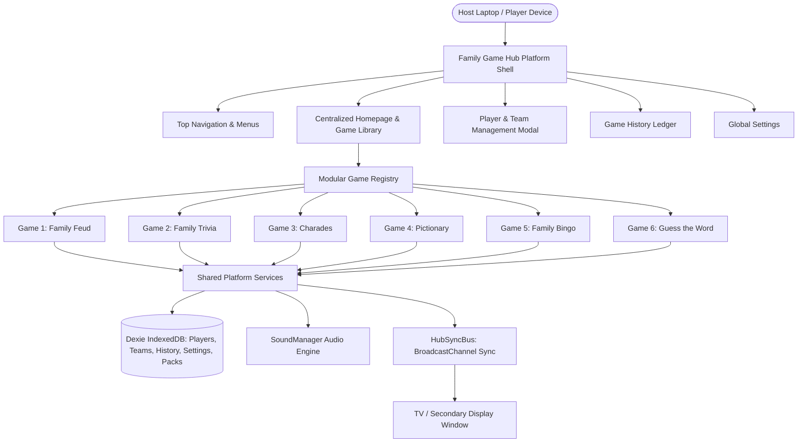

# Architectural Design Specification: Family Game Hub

- **Document ID**: `docs/superpowers/specs/2026-11-10-family-game-hub-design.md`
- **Date**: 2026-11-10
- **Status**: Ready for Implementation Planning
- **Author**: Antigravity Pair Programmer
- **Project**: Family Game Hub (Transformation from Family Feud Web App)

---

## 1. Overview & Vision

Family Game Hub transforms the existing Family Feud web application into an all-in-one local multiplayer family entertainment platform with the tagline **"One Place. Endless Family Fun."**

The platform operates without requiring a cloud backend or user accounts, running entirely in modern web browsers with local offline storage (Dexie IndexedDB) and peer screen synchronization (BroadcastChannel API). It enables a game host using a laptop or tablet to control the experience while mirroring an audience/player game board on a television or projector.

### Core Goals
1. **Preserve Family Feud**: 100% preservation of all 39 Filipino question packs, custom packs, Fast Money mode (20 sets/100 questions), sound synthesizer, strike mechanics, and two-screen synchronization.
2. **Modular Game Library**: Host 6 distinct, fully playable family party games:
   - **Family Feud** (TV Game Show)
   - **Family Trivia** (Multi-category Quiz Show)
   - **Charades** (Physical Acting & Guessing)
   - **Pictionary** (Real-Time Digital Drawing & Guessing)
   - **Family Bingo** (Automated Caller & Interactive Cards)
   - **Guess the Word** (Progressive Clue Word Puzzle)
3. **Shared Platform Kernel**: Shared player & team roster management, unified scoreboard, reusable game timer, centralized sound controller, persistent game history, and global settings.
4. **Two-Screen Experience**: Every game supports both Host Console mode (with host-only secrets/controls) and TV/Secondary Display mode (optimized for high-contrast 10-foot viewing).
5. **Anti-AI-Slop Craft Floor**: Implements strict token-driven styling, authentic typography, zero fake metrics or emojis-as-icons, and accessible responsive layouts across mobile (375px+), laptop (720p/1080p), and TV displays (1080p/4K).

---

## 2. System Architecture



### 2.1 File & Directory Organization

```
src/
├── audio/
│   ├── soundManager.ts             # Central sound engine with synthesized Web Audio + FX
│   └── gameSounds.ts               # Shared party game sound cues (chimes, whistles, buzzers)
├── components/
│   ├── common/                     # Reusable widgets (Navbar, Footer, AudioInitializer)
│   ├── display/                    # Feud-specific display components
│   ├── host/                       # Feud-specific host components
│   └── shared/                     # Hub-wide reusable UI components
│       ├── GameCard.tsx            # Card component for game library
│       ├── PlayerManagerModal.tsx  # Shared player/team manager
│       ├── SharedTimer.tsx         # Unified timer widget with controls & alerts
│       ├── SharedScoreboard.tsx    # Unified team/player score board
│       ├── WinnerPodiumModal.tsx   # Celebratory end-of-game summary
│       └── DrawingCanvas.tsx       # Reusable 2D canvas for drawing & display
├── data/
│   ├── fastMoney/                  # Feud Fast Money data
│   ├── filipinoPacks/              # Feud Filipino question packs
│   └── hubData/                    # Question & word banks for new games
│       ├── triviaQuestions.ts      # Multi-category trivia (General, Science, History, PH)
│       ├── charadesWords.ts        # Charades words & phrases (Movies, Animals, Actions)
│       ├── pictionaryWords.ts      # Pictionary words by difficulty
│       ├── bingoPatterns.ts        # Standard & fun bingo win patterns
│       └── wordClues.ts            # Guess the Word progressive clues
├── db/
│   ├── database.ts                 # Dexie v2 database (Feud tables + Hub tables)
│   └── hubDatabase.ts              # Hub-specific queries (players, history)
├── games/                          # Modular game implementations
│   ├── registry.ts                 # Game catalog definitions & metadata
│   ├── feud/                       # Family Feud module bridge
│   ├── trivia/                     # Family Trivia (Host & TV views, engine)
│   ├── charades/                   # Charades (Host & TV views, engine)
│   ├── pictionary/                 # Pictionary (Host & TV views, engine)
│   ├── bingo/                      # Family Bingo (Host & TV views, engine)
│   └── guessWord/                  # Guess the Word (Host & TV views, engine)
├── pages/
│   ├── MainHubPage.tsx             # Centralized Family Game Hub homepage
│   ├── GameSetupHubPage.tsx        # Pre-game configuration & roster assignment
│   ├── GameHistoryPage.tsx         # Saved games & statistics ledger
│   ├── GlobalSettingsPage.tsx      # Platform settings & sound controls
│   ├── HostConsolePage.tsx         # Existing Feud Host Console
│   ├── DisplayPage.tsx             # Existing Feud TV Display
│   ├── HubHostPage.tsx             # Dynamic Host runner for hub games
│   └── HubDisplayPage.tsx          # Dynamic TV runner for hub games
├── router/
│   └── Router.tsx                  # Hash router with TV window opener
├── sync/
│   ├── broadcast.ts                # Existing Feud sync bus
│   └── hubSync.ts                  # Hub-wide multi-game sync bus
└── types/
    ├── game.ts                     # Feud types
    └── hub.ts                      # Hub-wide types (Player, Team, GameSession, History)
```

---

## 3. Data Contracts & Database Schema

### 3.1 Dexie Database Versioning (`src/db/database.ts`)

To guarantee zero regression to existing Family Feud data, we upgrade Dexie to Version 2 by appending new stores without altering existing stores:

```typescript
export class FeudDatabase extends Dexie {
  questionPacks!: Table<QuestionPack, string>;
  gameSessions!: Table<GameSession, string>;
  settings!: Table<AppSettings, string>;
  
  // Hub Additions (Version 2)
  players!: Table<HubPlayer, string>;
  teams!: Table<HubTeam, string>;
  gameHistory!: Table<HubGameHistoryEntry, string>;

  constructor() {
    super('FamilyFeudGameShowDB');
    this.version(1).stores({
      questionPacks: 'id, title, category, isBuiltIn, updatedAt',
      gameSessions: 'id, updatedAt, phase',
      settings: 'id',
    });
    
    this.version(2).stores({
      players: 'id, name, teamId, createdAt',
      teams: 'id, name, color, score',
      gameHistory: 'id, gameId, gameTitle, datePlayed, winnerName',
    });
  }
}
```

### 3.2 Core Hub Models (`src/types/hub.ts`)

```typescript
export interface HubPlayer {
  id: string;
  name: string;
  teamId?: string | null;
  avatarColor: string;
  createdAt: string;
}

export interface HubTeam {
  id: string;
  name: string;
  color: 'blue' | 'red' | 'gold' | 'emerald' | 'purple' | 'amber';
  score: number;
  playerIds: string[];
}

export interface HubGameHistoryEntry {
  id: string;
  gameId: string;
  gameTitle: string;
  datePlayed: string;
  durationSeconds: number;
  gameMode: 'individual' | 'team';
  participants: Array<{ id: string; name: string; score: number; isWinner: boolean }>;
  winnerName: string;
  winnerScore: number;
}
```

---

## 4. Game Modules Specification

### Game 1: Family Feud (Existing — Preserved)
- **ID**: `family-feud`
- **Route**: `#/setup` (Setup), `#/game/:id` (Host), `#/display/:id` (TV).
- **Features**: Preserves all 39 built-in Filipino packs (195 questions), custom pack creation/editing in IndexedDB, Fast Money round with 20 sets / 100 questions, buzzer strikes, steal round, multiplier rounds (1x, 2x, 3x), and dual-screen synchronization.

---

### Game 2: Family Trivia
- **ID**: `family-trivia`
- **Description**: Fast-paced quiz show with multiple categories, timers, and automatic scoring.
- **Categories**:
  1. *General Knowledge* (Pop culture, science, everyday facts)
  2. *Science & Nature* (Planets, animals, physics, human body)
  3. *History & Geography* (World history, capitals, landmarks, wonders)
  4. *Entertainment & Movies* (Blockbusters, music, cartoons, TV shows)
  5. *Sports & Games* (Basketball, Olympics, board games, athletes)
  6. *Philippine Trivia* (Pinoy history, provinces, landmarks, food, icons)
- **Format**: Multiple-Choice (4 options) and True/False questions.
- **Host Console**:
  - Question view with correct answer highlighted.
  - Controls to reveal question, start timer, reveal options, reveal correct answer, and award points.
  - Option to create custom trivia questions stored in IndexedDB.
- **TV Display**:
  - Displays large question text, category badge, and 4 high-contrast answer option cards.
  - Reveals correct answer with celebratory green pulse and audio chime.
  - Live leaderboard showing team/player standings.

---

### Game 3: Charades
- **ID**: `charades`
- **Description**: High-energy party acting game where players act out words or phrases without speaking.
- **Categories**: *Movies & TV*, *Animals & Nature*, *Actions & Verbs*, *Professions & Jobs*, *Famous Characters & People*, *Objects & Household Items*.
- **Difficulty Levels**: Easy (1 pt), Medium (2 pts), Hard (3 pts).
- **Gameplay**:
  - Host triggers "Generate Word".
  - **Secret Word is strictly visible ONLY on Host Console**.
  - Host starts the countdown timer (30s, 60s, or 90s).
  - Actor acts; teammates guess.
  - Host clicks "Correct!" (+points awarded) or "Skip".
  - Host can reveal the word to the TV audience after the round ends.
- **TV Display**:
  - Dramatic big-screen countdown timer.
  - Active actor/team indicator.
  - Word card showing `[ ACTING IN PROGRESS - GUESS THE WORD! ]` until round conclusion.
  - Current scoreboard.

---

### Game 4: Pictionary
- **ID**: `pictionary`
- **Description**: Drawing and guessing game featuring a real-time digital drawing board.
- **Word Bank**: Rich collection of everyday objects, animals, places, and actions categorized by difficulty.
- **Host Console Canvas**:
  - HTML5 2D `<canvas>` with touch and pointer event support.
  - Tools: Pen (with stroke size 2px, 4px, 8px, 16px), Eraser, Color Palette (Black, Red, Blue, Green, Yellow, Orange, Purple), and Clear Board.
  - Displays the secret word and category to the artist/host.
  - Timer and scoring controls ("Correct Guess" / "Pass").
- **TV Display**:
  - Full-screen mirrored canvas rendered in real-time via `hubSyncBus.broadcastCanvas(strokeData)`.
  - Secret word remains completely hidden.
  - Prominent countdown timer and score ticker.

---

### Game 5: Family Bingo
- **ID**: `family-bingo`
- **Description**: Interactive family bingo with random number caller, tracking master board, and custom winning patterns.
- **Features**:
  - **Ball Caller (B-I-N-G-O 1–75)**: Random number picker with visual ball roll animation and voice/chime announcement.
  - **Master Board**: 75-number tracking grid displaying all called numbers with highlights.
  - **Interactive Bingo Cards**: Host can generate and print or display digital 5x5 bingo cards (with FREE center) for players.
  - **Winning Patterns**: Configurable rules: *Standard Line (Horizontal, Vertical, Diagonal)*, *Four Corners*, *Postage Stamp*, *Blackout / Full Card*.
  - **Verification**: Instant card verification tool where host types card number or checks matches.
- **TV Display**:
  - TV shows the large Last Called Ball with its column letter (`B-12`, `I-24`, `G-56`).
  - Full 75-number master grid with called numbers highlighted in gold.
  - Flashing celebratory banner when "BINGO!" is called and verified.

---

### Game 6: Guess the Word
- **ID**: `guess-the-word`
- **Description**: Clue-by-clue word puzzle game where points decrease as more clues are revealed.
- **Gameplay**:
  - Each puzzle has 1 Secret Word and 4 progressive clues (ranging from cryptic/general to obvious).
  - Clue 1 revealed: Guessing correctly earns 40 pts.
  - Clue 2 revealed: Guessing correctly earns 30 pts.
  - Clue 3 revealed: Guessing correctly earns 20 pts.
  - Clue 4 revealed: Guessing correctly earns 10 pts.
  - Host controls clue reveals, timer, and score allocation.
- **TV Display**:
  - Secret word masked as blanks or mystery box (`_ _ _ _ _`).
  - Clues appear sequentially with smooth animations.
  - Full answer reveal with confetti on correct guess.

---

## 5. Shared Platform Services

### 5.1 Shared Screen Synchronization (`src/sync/hubSync.ts`)
Using the standard browser `BroadcastChannel('family-game-hub-sync-v1')`, messages are distributed between Host and TV displays with zero lag:
- `HUB_STATE_UPDATE`: Syncs active game, phase, scores, and game-specific payloads.
- `CANVAS_DRAW_STROKE`: Real-time vector stroke broadcasting for Pictionary.
- `CANVAS_CLEAR`: Clears the TV canvas immediately.
- `TRIGGER_SOUND`: Plays synchronized sound effects across selected audio destinations.
- `TIMER_TICK`: Propagates synchronized timer values.
- `REQUEST_SYNC` & `HEARTBEAT_PING/PONG`: Recovers state on TV refresh or late connect.

### 5.2 Shared Sound System (`src/audio/soundManager.ts`)
Synthesized Web Audio API sounds ensuring 100% royalty-free, zero-network-dependency playback:
- Game show bells, correct dings, buzzers, countdown tick-tocks, drum rolls, winner fanfares, and bingo ball drops.
- Volume controls for master, effects, and background ambiance.
- Destination switcher (`auto`, `tv_only`, `host_only`, `both`).

### 5.3 Shared Player & Team Management
- Host can add unlimited players with custom names and avatar colors.
- Quick team assignment (Team Blue vs. Team Red, or multi-team up to 4 teams).
- Reusable across all 6 games without re-entering family member names every round.

### 5.4 Game History & Persistence
- Automatically records completed game sessions into IndexedDB table `gameHistory`.
- Records: game name, date/time, participants, final scores, winner, and elapsed duration.
- Management UI: Filter by game, view match summaries, or clear history.

---

## 6. UI/UX Design System & Anti-Slop Discipline

Following the Mandatory Anti-AI-Slop Stack (`hallmark`, `ui-ux-pro-max`, `taste-skill`, `impeccable`):

### 6.1 Theme & Color Palette
Declared as CSS variables at `:root` (`src/index.css`):
- `--hub-bg`: `#060b18` (deep navy midnight)
- `--hub-surface`: `#0d172e` (elevated card surface)
- `--hub-surface-hover`: `#142346`
- `--hub-border`: `#1e293b`
- `--hub-text-main`: `#f8fafc`
- `--hub-text-muted`: `#94a3b8`

**Game Accent Colors**:
- Family Feud: `--color-feud: #ffd15c` (Marquee Gold)
- Family Trivia: `--color-trivia: #38bdf8` (Electric Sky)
- Charades: `--color-charades: #fb7185` (Sunset Coral)
- Pictionary: `--color-pictionary: #34d399` (Emerald Mint)
- Family Bingo: `--color-bingo: #fbbf24` (Golden Amber)
- Guess the Word: `--color-word: #a78bfa` (Royal Violet)

### 6.2 Strict Quality Rules
- Zero purple-to-blue generic gradients.
- Zero fake metrics, fake testimonials, or emojis used as functional icons.
- All functional icons use `@phosphor-icons/react` or `lucide-react` with uniform `strokeWidth={2}`.
- Every interactive button has instant, visible `:focus-visible` styling (`outline: 2px solid var(--hub-accent)`).
- Animations utilize `transform` and `opacity` only (never `transition: all`, never animating `width` or `height`).
- Full support for `prefers-reduced-motion`.
- Responsive layout verified from 375px mobile screens up to 4K TV displays.

---

## 7. Verification & Testing Strategy

1. **Unit & Integration Tests (Vitest)**:
   - Data bank validation (trivia questions, charades phrases, pictionary words, bingo 1-75 range, word clues).
   - Dexie database v2 schema upgrade and backward compatibility with Feud tables.
   - Hub sync broadcast message serialization and handling.
   - Shared timer state logic and scoring calculations.
2. **End-to-End Tests (Playwright)**:
   - Hub homepage rendering with all 6 game cards.
   - Launching Family Feud directly from the hub (verifying pack selection & gameplay).
   - Playing a round of Family Trivia, Charades, Pictionary, Bingo, and Guess the Word.
   - Opening TV display window and verifying state synchronization.
   - Player/Team management and saving game history.
3. **Build & Typecheck**:
   - `tsc -b && vite build` passing with 0 errors.

---

## 8. Spec Self-Review Checklist

- [x] **Placeholder Scan**: No "TBD", "TODO", or vague requirements. Every game has defined mechanics, rules, and UI modes.
- [x] **Internal Consistency**: Data contracts in Section 3 match all game module descriptions in Section 4.
- [x] **Scope Check**: Fits within the modular architecture where each game is an isolated module communicating through shared platform services.
- [x] **Ambiguity Check**: Two-screen architecture, secret word visibility rules, and backward compatibility are explicitly detailed.
